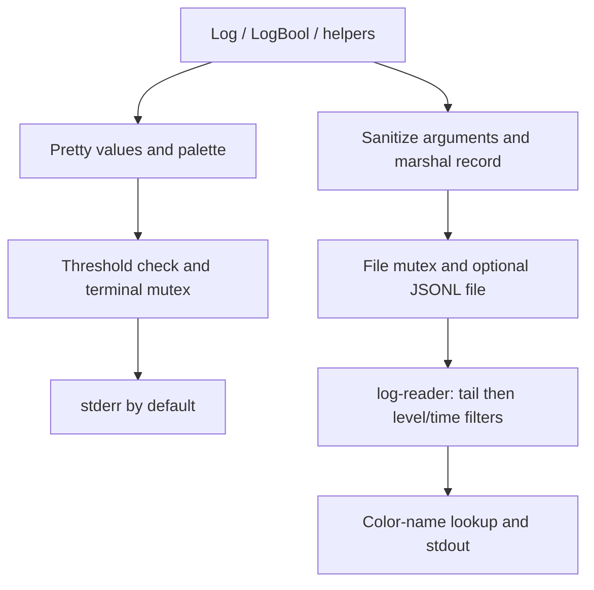

# tintlog

A zero-dependency Go logging helper with colored terminal output, optional JSONL files, and a command for reading saved logs.

- Named logging levels from Critical (0) through Debug9 (89); smaller numbers indicate greater severity.
- Configurable terminal threshold, timestamps, and optional goroutine IDs.
- Foreground, background, bold, bright, and dim truecolor styles.
- JSONL records containing timestamp, level, color name, original format, and sanitized arguments.
- Reader filters for level, inclusive time bounds, and the last N physical lines.


## Setup and usage

The current module declares Go 1.25.5. Add it to your application with:

```sh
go get github.com/tuumbleweed/tintlog@v0.0.10
```

```go
package main

import (
    tl "github.com/tuumbleweed/tintlog/logger"
    "github.com/tuumbleweed/tintlog/palette"
)

func main() {
    tl.InitializeConfig(&tl.Config{
        LogLevel: tl.Info,
        LogDir: "./log",
    })
    tl.Log(tl.Info, palette.Green, "Processed %s records", 42)
    tl.Log(tl.Debug, palette.GrayDim, "Details: %s", map[string]any{"ready": true})
}
```

The Info threshold prints levels up to 50 to stderr. File logging, when enabled, receives all levels, including the Debug message above. Without a log directory, logging defaults to terminal output only. Configuration initialization itself emits messages before opening the file. Zero-valued configuration fields are filled from defaults; consequently, setting Critical (0) through `InitializeConfig` does not select a threshold of zero. Configure the logger before concurrent use.

Arguments are converted to display strings before formatting. Use `%s` or `%v`; numeric verbs such as `%d` do not retain ordinary `fmt.Printf` behavior. Level names do not cause process termination.



From a checkout, run the demonstration (it creates files in `./log/`):

```sh
go run ./examples/colors
```

Read a generated file by substituting its actual timestamped path:

```sh
go run ./cmd/log-reader --file ./log/FILE.jsonl --level 59 --tail 100
```

Limit the time range using the default Go time layout:

```sh
go run ./cmd/log-reader --file ./log/FILE.jsonl \
  --start '2025/Nov/09 12:00:00' --end '2025/Nov/09 13:00:00'
```

Bounds are parsed in UTC with the default layout. `--time-format` changes bound parsing, not output formatting. `--tail` selects physical file lines before filtering, and the reader loads the entire file into memory. Do not pass empty time bounds: both are always parsed.

## Status and limitations

The library has tagged versions through v0.0.10 and an MIT license in `LICENSE`. No automated tests are included. Formatting, serialization, and write failure handling remain limited; file records are best effort. Reopening an existing filename does not append safely. The reader uses the scanner's default token size, so large records can fail to read. Custom color names need registration in the reader to recover their styling.

A Docker Compose color demo is included, but its builder image specifies Go 1.25.3 while the module requires 1.25.5; toolchain auto-download or an aligned image is needed. The example writes inside the container because Compose defines no log volume.
