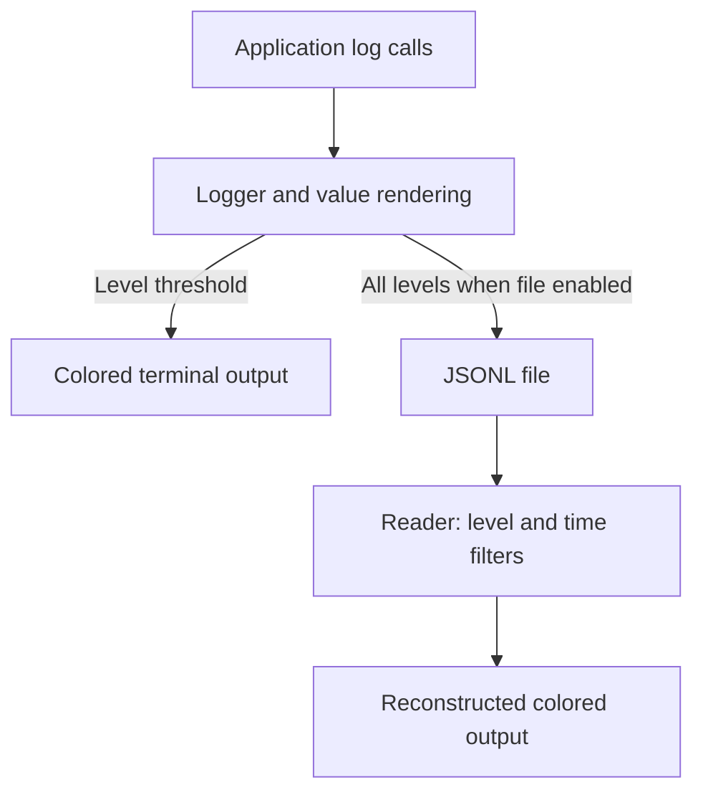

# tintlog

## Overview

tintlog is a small Go logging library that combines readable terminal messages with optional JSON Lines (JSONL) records for later inspection. A companion command filters saved messages by logging level and time range. The implementation uses only the Go standard library.

## My Contributions

Repository implementation work includes a numeric logging hierarchy, configurable terminal output, JSONL record storage, a log reader, and a reusable ANSI truecolor palette. The logger preserves original format strings and sanitized arguments separately, while the reader uses stored color names to reconstruct styled output.

## Architecture

## Technical Challenges

Terminal readability and stored data need different representations. tintlog formats values for display while separately serializing raw arguments, converting errors to strings and byte slices to tagged base64 objects. Named colorizers allow the reader to recover known styles without adding logger-generated ANSI styling to stored arguments. Mutexes serialize writes independently to the terminal and file.

## Results and Current State

The repository contains the library, a color demonstration, and the reader command. The owner describes development as mostly finished with occasional maintenance; local tags reach v0.0.10. There are no automated tests or benchmark results in the repository. Serialization and output failures are not reported to callers, so durable delivery is not guaranteed.

## Development History

Observed Git activity begins on November 9, 2025, with logging, JSONL storage, the reader, and palette work. November 10 brought package separation, naming changes, and JSON/rewrite helpers. A preview was added on November 11. The latest observed change, January 14, 2026, updates the Go version requirement. These dates describe available Git history, not verified project start or completion dates.
